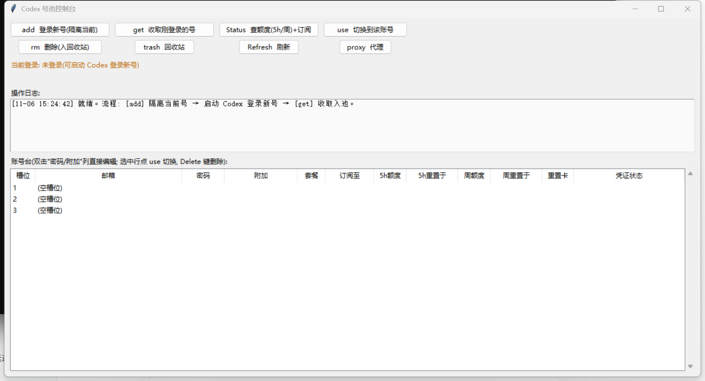

# codex-pool — Multi-account pool manager for OpenAI Codex

English | [简体中文](README.md)

Manage multiple ChatGPT accounts for Codex Desktop / CLI on Windows: each
account's credentials (`~/.codex/auth.json`) are snapshotted into named slots,
with one-click switching, quota monitoring and a recycle bin for dead accounts.

> ⚠️ **Disclaimer**: rotating multiple accounts may violate OpenAI's Terms of
> Service (rate-limit circumvention). This tool is for studying local
> credential management only. Any consequence of using it (including account
> bans) is your own responsibility.



## Download / Install

- **Standalone builds**: grab `codex-pool-gui.exe` (GUI) or `codex-pool.exe`
  (CLI) from [Releases](../../releases) — no Python required. The executables
  are built automatically by GitHub Actions
  ([build-release.yml](.github/workflows/build-release.yml)). PyInstaller
  binaries may trigger antivirus false positives; run from source if that
  bothers you.
- **From source**: see below.

## Features

- **Pool lifecycle**: `add` (isolate current login, then log a new account in) /
  `get` (capture & validate the new login) / `use` (switch) / `rm` (move to
  recycle bin)
- **GUI console** (Tkinter, zero third-party deps): control panel + scrollable
  account table; double-click the Password/Note columns to edit them inline;
  select a row and switch with one click
- **Quota monitoring**: queries the official endpoint for each account's 5-hour
  and weekly window usage, reset times, and remaining rate-limit reset credits;
  auto-detects both the legacy dual-window model and the newer weekly-only model
- **Account idempotency**: one account maps to exactly one slot; re-capturing
  refreshes the original slot, never creates duplicates
- **Switch safety**: 45 s cooldown between switches, cross-process file lock
  (GUI & CLI mutually exclusive), auto-quit Codex before touching files,
  atomic writes + read-back verification, timestamped backups before every
  modification
- **Recycle bin**: deleted accounts go to `~/.codex-pool/trash/` and can be
  restored or purged at any time
- **Proxy auto-detection**: finds the system proxy or probes common local
  proxy ports (Clash / V2Ray, etc.); manual override supported

## Install

Requirements: Windows + Python 3.8+ (tkinter is bundled — no third-party
dependencies).

Put `codex-pool.py` and `codex-pool-gui.py` in the **same directory**, then:

```bat
:: CLI
python codex-pool.py status

:: GUI
pythonw codex-pool-gui.py
```

All data lives under `~/.codex-pool/` (slots, passwords, backups, trash).

## Quick start

```bat
codex-pool capture 1        :: snapshot the currently logged-in account into slot 1
codex-pool add 2            :: isolate the current login, then log the new
                             :: account in inside Codex (capture it afterwards)
codex-pool use 2            :: switch to slot 2 (Codex Desktop must be closed)
codex-pool status           :: show the pool
```

With the GUI it is even simpler: `add` → open Codex and log the new account in
→ `get` → done. Click `Status` to refresh quotas; select a row and click `use`
to switch accounts.

## GUI reference

The UI is bilingual — press the `中/EN` button (bottom-right of the button
rows) to switch between Chinese and English. The table below lists the Chinese
labels in case you run it in Chinese:

Buttons (top panel):

| Label | Meaning |
|---|---|
| `add  登录新号(隔离当前)` | Quit Codex, isolate the current login, prepare a slot for a new login |
| `get  收取刚登录的号` | Capture the newly logged-in account into the pool (validates it) |
| `Status  查额度(5h/周)+订阅` | Query every account's 5h/weekly usage, reset times & reset credits |
| `use  切换到该账号` | Switch Codex to the selected account |
| `import  导入JSON` | Import an external auth.json credential file into the pool (for token-only accounts; no login needed) |
| `rm  删除(入回收站)` | Move the selected account to the recycle bin |
| `trash  回收站` | Recycle bin (restore / purge) |
| `Refresh  刷新` | Refresh the table locally (no network) |
| `auto  自动切换` | Auto-switch settings (off / shadow = alert-only / exec = switch when maxed; dynamic check intervals, hourly cap, optional auto-relaunch) |
| `proxy  代理` | Proxy settings (`auto` / `none` / a URL) |

Table columns:

| Column | Meaning |
|---|---|
| 槽位 | Slot number |
| 邮箱 | Account email (auto-detected from the token) |
| 密码 | Password (double-click the cell to edit) |
| 附加 | Free-form note, e.g. seller / purchase date (double-click to edit) |
| 套餐 | Plan (`plus`) |
| 订阅至 | Subscription active until |
| 5h额度 / 5h重置于 | 5-hour window usage % / absolute reset time (`无` = the account is on the weekly-only model) |
| 周额度 / 周重置于 | Weekly window usage % / absolute reset time |
| 重置卡 | Remaining rate-limit reset credits (shared across windows) |
| 凭证状态 | Token validity |

Other cues:

- Orange banner `当前登录: … [未入池 → 建议点 get 收取]` — the current login is
  not in the pool yet; press `get`.
- A red row means that account is currently rate-limited (maxed out).
- Select a row and press `Delete` to remove it; double-click other columns
  does nothing (switching is a deliberate button click).
- Log keywords: `打满` = maxed out · `冷却` = cooldown in effect ·
  `受保护` = protected action refused · `凭证失效(401)` = token dead, re-login
  needed.

## CLI commands

| Command | Action |
|---|---|
| `add <slot>` | run `codex login` in an isolated CODEX_HOME (current login untouched) |
| `capture <slot>` | snapshot the current login into a slot (idempotent, one account per slot) |
| `use <slot>` | switch slots (cooldown / lock / verification / backup included) |
| `rm <slot>` | move to recycle bin (refuses if the account is currently logged in) |
| `status` | show the live login and all slots |

## Security notes

- `~/.codex-pool/` contains OAuth credentials **and plaintext passwords** —
  treat it as the accounts themselves. Never commit it (already excluded by
  `.gitignore`), never sync it to the cloud, never share it.
- Every modification of `auth.json` is preceded by a timestamped backup in
  `~/.codex-pool/backups/`.
- Always let the tool quit Codex Desktop for you before a switch — it verifies
  the swap afterwards.

## VPS remote monitor (optional, read-only)

See quotas and ban alerts while away from the machine:

```bash
# 1) On the VPS (Ubuntu/Debian, python3 only, zero deps):
mkdir -p /opt/codex-pool-monitor
scp codex-pool.py codex-pool-monitor.py deploy/codex-pool-monitor.service user@vps:/opt/codex-pool-monitor/
cat > /opt/codex-pool-monitor/monitor-config.json <<'EOF'
{"port": 8787, "auth_key": "use-a-strong-random-string", "poll_minutes": 20,
 "telegram_bot_token": "", "telegram_chat_id": "", "webhook_url": ""}
EOF
sudo cp /opt/codex-pool-monitor/codex-pool-monitor.service /etc/systemd/system/
sudo systemctl enable --now codex-pool-monitor

# 2) Open port 8787 in the firewall/security group

# 3) In the GUI press [vps Monitor], enter http://<vps-ip>:8787 + auth_key, save
```

- Read-only: the server only calls the free usage endpoint; it holds
  access_tokens but **never refreshes** and never switches.
- Alerts: dead token (401) / maxed out / all-maxed → Telegram or webhook.
- ⚠ Plain HTTP exposes tokens in transit — front it with TLS (caddy/nginx) or
  use an SSH tunnel in production.

## Known limitations

- Windows only (process control via taskkill/tasklist; proxy detection reads
  the registry).
- The quota endpoint (`chatgpt.com/backend-api/codex/usage`) is unofficial;
  field changes may break the quota columns (pool core features are unaffected).

## License

[MIT](LICENSE)
