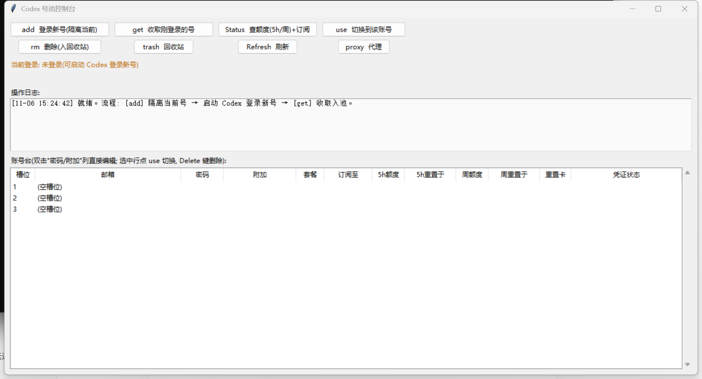

# codex-pool — Codex 多账号号池管理器

[English](README.en.md) | 简体中文

Windows 下为 Codex Desktop / CLI 管理多个 ChatGPT 账号：把各账号的登录凭证
（`~/.codex/auth.json`）快照到命名槽位，一键切换、查询额度、账号报废回收。

> ⚠️ **风险声明**：多账号轮换可能违反 OpenAI 使用条款（规避速率限额）。
> 本工具仅供学习研究本地凭证管理机制，使用产生的任何后果（含账号封禁）自负。



## 下载 / 安装

- **免安装版**：从 [Releases](../../releases) 下载 `codex-pool-gui.exe`（图形界面）或
  `codex-pool.exe`（命令行），无需安装 Python。exe 由 GitHub Actions 自动构建，
  配置见 [build-release.yml](.github/workflows/build-release.yml)。
  PyInstaller 打包的 exe 可能被杀毒软件误报，介意请用源码方式运行。
- **源码版**：见下方安装说明。

## 功能

- **号池管理**：`add`（隔离当前登录，登录新号）/ `get`（收取并验证新号）/
  `use`（切换）/ `rm`（移入回收站）完整生命周期
- **JSON 凭证导入**：直接导入外部 auth.json 凭证文件入池（免登录流程，
  适配"仅 Codex 凭证"类账号），自动识别重复账号
- **GUI 控制台**（Tkinter，无第三方依赖）：操作台 + 可滚动账号台账，
  双击"密码/附加"列直接编辑，选中行一键切换
- **额度监控**：官方接口查询各账号 5h / 周窗口用量、重置时间、重置卡余量；
  自动识别新版"仅周额度"账号与旧版双窗口账号
- **账号幂等**：一号一槽，重复收取自动刷新原槽位，绝不产生重复槽位
- **切换防护**：45 秒冷却防连切、GUI/CLI 跨进程文件锁、
  切换前自动退出 Codex、原子写入 + 写后回读校验、改动前时间戳备份
- **自动切换**（可选）：影子模式只告警 / 执行模式打满自动换号；
  least_used 选号（周额度优先）、动态检查间隔（30/10/5 分钟三档）、
  每小时切换上限、切换后可自动重启 Codex Desktop
- **回收站**：删除的账号进 `~/.codex-pool/trash/`，可随时恢复或彻底清空
- **中英双语界面**：`中/EN` 按钮一键切换, 语言选择持久化
- **代理自适应**：自动探测系统代理 / 本机常见代理端口（Clash/V2Ray 等），
  可手动指定

## 安装

要求：Windows + Python 3.8+（自带 tkinter，无第三方依赖）。

把 `codex-pool.py` 和 `codex-pool-gui.py` 放在**同一目录**，然后：

```bat
:: 命令行版
python codex-pool.py status

:: GUI 版
pythonw codex-pool-gui.py
```

数据目录固定在 `~/.codex-pool/`（槽位/密码/备份/回收站都在这里）。

## 快速开始

```bat
codex-pool capture 1        :: 把当前已登录的账号收进槽位 1
codex-pool add 2            :: 隔离当前登录, 之后在 Codex 里登录新号
                             :: (登录完成后 GUI 点 get / CLI capture 2)
codex-pool use 2            :: 切换到槽位 2 (需先完全退出 Codex)
codex-pool status           :: 查看池子
```

GUI 流程更简单：`add` → 打开 Codex 登录新号 → `get` → 完成入池；
日常点 `Status` 看额度，选中行点 `use`（或选行后确认）切换。

## 命令一览（CLI）

| 命令 | 作用 |
|---|---|
| `add <slot>` | 在隔离目录发起 `codex login`，不动当前登录 |
| `capture <slot>` | 把当前登录收进槽位（幂等，一号一槽） |
| `use <slot>` | 切换槽位（带冷却/锁/校验/备份全套防护） |
| `rm <slot>` | 移入回收站（当前登录中的号受保护拒删） |
| `status` | 查看登录状态与所有槽位 |

## 安全须知

- `~/.codex-pool/` 内含账号 OAuth 凭证与**明文密码**，等同账号本体：
  不要提交到任何仓库（本项目 `.gitignore` 已排除）、不要同步网盘、不要外发。
- 每次改动 `auth.json` 前都会自动备份到 `~/.codex-pool/backups/`，
  误操作可从备份恢复。
- 切换账号请先完全退出 Codex Desktop，工具会自动处理并校验。

## VPS 远程监控部署(可选, 只读)

人不在电脑前也能看到额度/封号告警:

```bash
# 1) VPS 上(Ubuntu/Debian, 需 python3, 无第三方依赖):
mkdir -p /opt/codex-pool-monitor
scp codex-pool.py codex-pool-monitor.py deploy/codex-pool-monitor.service user@vps:/opt/codex-pool-monitor/  # service 放 /etc/systemd/system/
cat > /opt/codex-pool-monitor/monitor-config.json <<'EOF'
{"port": 8787, "auth_key": "换成强随机串", "poll_minutes": 20,
 "telegram_bot_token": "", "telegram_chat_id": "", "webhook_url": ""}
EOF
sudo cp /opt/codex-pool-monitor/codex-pool-monitor.service /etc/systemd/system/
sudo systemctl enable --now codex-pool-monitor

# 2) 防火墙/安全组放行 8787(仅此端口)

# 3) 本地 GUI 点 [vps 监控] 填 http://<vps-ip>:8787 和 auth_key, 保存即同步
```

- 只读: 服务端只调用免费 usage 接口, 持有 access_token 但**绝不刷新**、绝不切换;
- 告警: 凭证失效(401)/打满/全员打满 → Telegram 或 Webhook;
- ⚠️ 明文 HTTP 下 token 传输可被窃听, 生产建议套 TLS(caddy/nginx)或仅走 SSH 隧道。

## 已知边界

- 仅支持 Windows（进程管理用 taskkill/tasklist，代理探测读注册表）。
- **多账号的固有代价**：Codex 的对话线程与"项目分组"跟随账号
  （每个会话带 creator_account_id 标签）。切换账号后，旧账号创建的线程
  会显示在"其它"分组下（数据未丢）；切回原账号即可恢复分组，或在当前
  账号下于项目文件夹内开新线程重新建立归属。
- 额度接口为非公开接口（`chatgpt.com/backend-api/codex/usage`），
  字段变动可能导致额度列显示异常（不影响号池核心功能）。

## License

[MIT](LICENSE)
